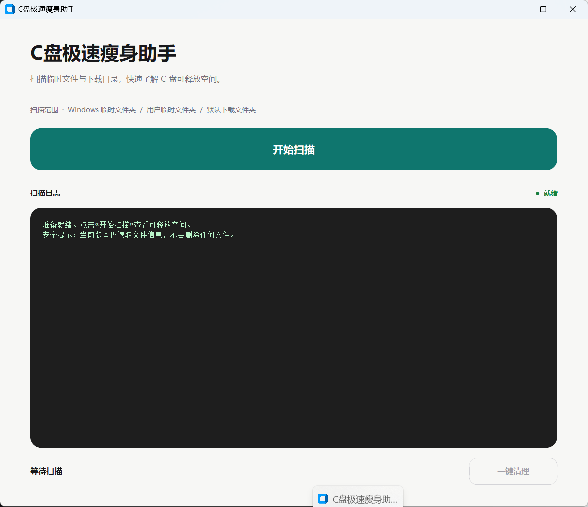

# C盘极速瘦身助手
[](https://github.com/Auraiiiii/C-Drive-Cleaner/releases/tag/v1.0.0)

<sub>⚠️ 注意：Windows 可能会提示未知发布者，这是因为未购买代码签名证书，点击“更多信息”->“仍要运行”即可。</sub>

> 面向 Windows 的只读磁盘空间分析工具，帮助用户快速了解临时目录与下载目录的空间占用。


## 界面预览

<div align="center">



*C盘极速瘦身助手图形界面*

</div>

## 核心功能

- **安全扫描**：只读分析 Windows 临时文件夹、用户临时文件夹和默认下载文件夹。
- **空间分析**：统计各目录的总占用和文件数量，并列出其中最大的文件。
- **实时日志**：扫描过程在图形界面中持续输出进度、目录结果和异常提示。
- **权限容错**：无法访问的文件或目录会被跳过并计数，不会中断整个扫描。
- **双入口支持**：提供简洁的图形界面，同时保留可用于终端检查的命令行版本。

## 安全声明

> **本项目当前版本仅为“只读扫描”，绝对不会擅自删除、移动、修改或重命名用户的任何文件。**

项目的安全边界如下：

- 扫描器只遍历目录并读取文件元数据，不读取文件内容。
- 图形界面中的“一键清理”按钮仅显示“功能开发中”提示，不执行任何文件操作。
- 扫描结果只显示在本地界面或终端中，不会上传到网络。
- 程序不要求管理员权限，仅能访问当前账号有权读取的内容。
- 符号链接目录不会被跟随，以降低重复统计和目录循环的风险。

> [!IMPORTANT]
> 扫描结果中的“占用空间”不等于“可以安全删除的垃圾”。临时文件和下载内容仍可能被正在运行的程序或用户使用。在实现并审核可靠的安全清理流程前，本项目不会自动删除任何内容。

## 扫描范围

| 扫描目标 | 默认位置 | 说明 |
| --- | --- | --- |
| Windows 临时文件夹 | `%SystemRoot%\Temp` | 系统级临时文件 |
| 用户临时文件夹 | `%TEMP%` | 当前用户的临时文件 |
| 默认下载文件夹 | `~/Downloads` | 当前用户的下载内容 |

每个目录会显示总逻辑大小、文件数量，以及超过 10 MB 的最大 5 个可读取文件。由于权限限制或文件状态变化而无法读取的条目会被跳过，并在结果中单独统计。

## 快速开始

### 环境要求

- Windows 10 / 11
- Python 3.10 或更高版本
- [CustomTkinter](https://customtkinter.tomschimansky.com/)

### 安装与运行

```bash
git clone <repository-url>
cd C-Drive-Cleaner
python -m pip install customtkinter
python gui_cleaner.py
```

启动后点击“开始扫描”即可查看各目录的空间占用。当前版本不会执行清理操作；扫描结束后可通过“重新扫描”刷新结果。

### 命令行模式

如果只需要在终端中查看报告，可以运行：

```bash
python main.py
```

扫描期间可按 `Ctrl+C` 安全终止。程序只会停止读取，不会修改任何文件。

## 结果说明

- 大小按二进制单位换算，例如 `1 MB = 1024 KB`。
- 统计值表示文件逻辑大小，可能与磁盘实际分配空间略有差异。
- 普通文件才会计入统计，目录和符号链接不计入文件大小。
- 无权限或扫描期间发生变化的条目会被跳过，因此报告中的占用可能低于实际值。

## 项目结构

```text
C-Drive-Cleaner/
├── main.py          # 只读扫描逻辑与命令行报告
├── gui_cleaner.py   # CustomTkinter 图形界面
├── README.md
└── LICENSE
```

## 参与贡献

欢迎通过 Issue 反馈问题，或通过 Pull Request 提交改进。涉及文件修改、清理策略或权限处理的变更，应优先保证只读安全边界，并补充相应测试与说明。

## 许可证

本项目基于 [MIT License](LICENSE) 开源。
